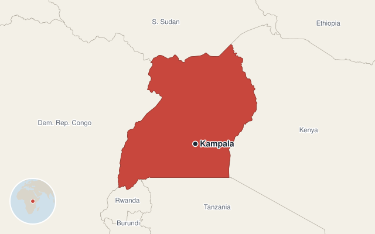

---
id    = "eb0c6afb-407b-5f17-9f33-c9623f28042a"
model = "Basic"
tags  = ["africa", "east_africa", "sovereign_state", "capital"]
---

## Front

What is the capital of <b>Uganda</b>?

## Back

<b>Kampala</b>

## Extra

About 1.8 million people in the city proper (2024 census) 1,190 m up, on the Buganda hills

The name comes from "Hill of the Impala": British officials were given a hill that had been a hunting reserve of the Kabaka of Buganda, with many impala. Akasozi k'empala was shortened to Kampala.

<a href="https://en.wikipedia.org/wiki/Kampala">Kampala on Wikipedia</a> <a href="https://en.wikipedia.org/wiki/Uganda">Uganda on Wikipedia</a>
