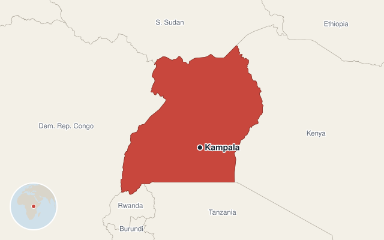

---
id    = "3e2b6639-3511-52c7-946f-9fc2cb824610"
model = "Basic"
tags  = ["africa", "east_africa", "sovereign_state", "country"]
---

## Front

<b>Kampala</b> is the capital of which country or territory?

## Back

<b>Uganda</b>

## Extra

About 45.9 million people (2024) Highest point: Mount Stanley

Named after the Buganda kingdom, which covers much of the south, including Kampala. English is the official language, with Swahili the second official language.

<a href="https://en.wikipedia.org/wiki/Uganda">Uganda on Wikipedia</a> <a href="https://en.wikipedia.org/wiki/Kampala">Kampala on Wikipedia</a>
