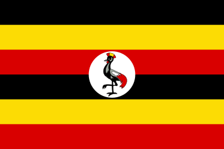
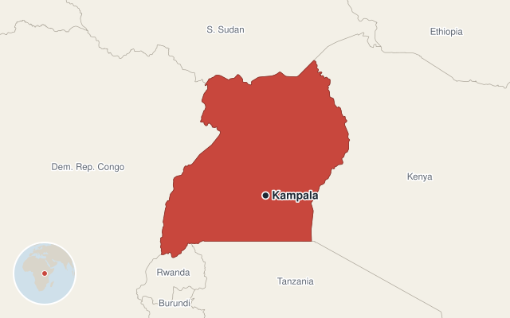

---
id    = "308dbb0b-b6ec-5a3b-a654-c57b61fd6258"
model = "Basic"
tags  = ["africa", "east_africa", "sovereign_state", "flag"]
---

## Front

Whose flag is this?

## Back

<b>Uganda</b>

## Extra

<a href="https://en.wikipedia.org/wiki/Flag_of_Uganda">Flag of Uganda on Wikipedia</a> <a href="https://en.wikipedia.org/wiki/Uganda">Uganda on Wikipedia</a>
