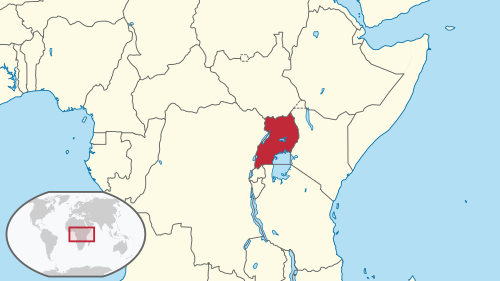
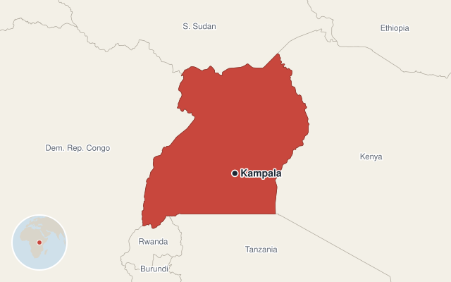

---
id    = "14b5d21f-25e8-58ed-8db7-e60609942ef1"
model = "Basic"
tags  = ["africa", "east_africa", "sovereign_state", "map"]
---

## Front

What is highlighted on this map?

## Back

<b>Uganda</b>

## Extra

<a href="https://en.wikipedia.org/wiki/Uganda">Uganda on Wikipedia</a>
