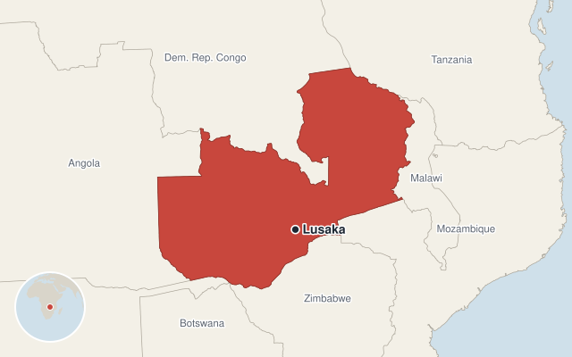

---
id    = "ffe82aeb-a487-5bc3-a3b8-75ea45bda233"
model = "Basic"
tags  = ["africa", "east_africa", "sovereign_state", "capital"]
---

## Front

What is the capital of <b>Zambia</b>?

## Back

<b>Lusaka</b>

## Extra

<a href="https://en.wikipedia.org/wiki/Lusaka">Lusaka on Wikipedia</a> <a href="https://en.wikipedia.org/wiki/Zambia">Zambia on Wikipedia</a>
