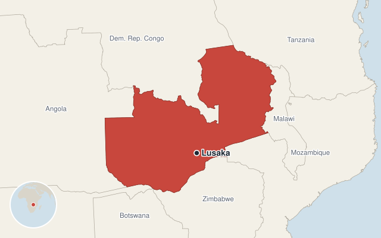

---
id    = "f4262d5b-1f97-538a-b768-97fb8cefa43c"
model = "Basic"
tags  = ["africa", "east_africa", "sovereign_state", "country"]
---

## Front

<b>Lusaka</b> is the capital of which country or territory?

## Back

<b>Zambia</b>

## Extra

<a href="https://en.wikipedia.org/wiki/Zambia">Zambia on Wikipedia</a> <a href="https://en.wikipedia.org/wiki/Lusaka">Lusaka on Wikipedia</a>
