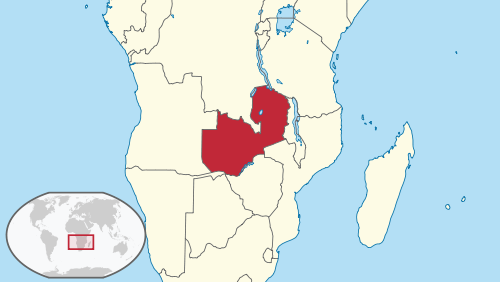

---
id    = "6c21260a-2eb1-5326-8ea8-e144a957f055"
model = "Basic"
tags  = ["africa", "east_africa", "sovereign_state", "map"]
---

## Front

What is highlighted on this map?

## Back

<b>Zambia</b>
