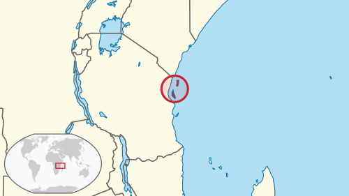

---
id    = "da0dd7e3-f6ae-50b1-ac0f-463f952161c0"
model = "Basic"
tags  = ["africa", "map"]
---

## Front

What is highlighted on this map?

## Back

<b>Zanzibar</b>

## Extra

Semi-autonomous region of Tanzania.
