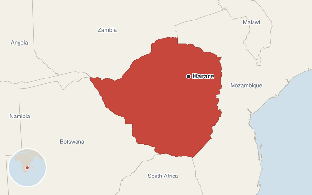

---
id    = "766001af-9dc0-55b4-bf1b-f64f1ca53894"
model = "Basic"
tags  = ["africa", "east_africa", "sovereign_state", "capital"]
---

## Front

What is the capital of <b>Zimbabwe</b>?

## Back

<b>Harare</b>

## Extra

<a href="https://en.wikipedia.org/wiki/Harare">Harare on Wikipedia</a> <a href="https://en.wikipedia.org/wiki/Zimbabwe">Zimbabwe on Wikipedia</a>
