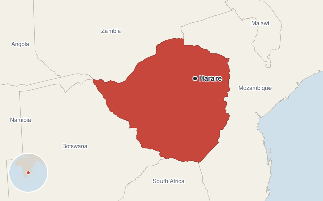

---
id    = "51c5844b-bc93-5832-9347-96bd49d37db5"
model = "Basic"
tags  = ["africa", "east_africa", "sovereign_state", "country"]
---

## Front

<b>Harare</b> is the capital of which country or territory?

## Back

<b>Zimbabwe</b>

## Extra

<a href="https://en.wikipedia.org/wiki/Zimbabwe">Zimbabwe on Wikipedia</a> <a href="https://en.wikipedia.org/wiki/Harare">Harare on Wikipedia</a>
