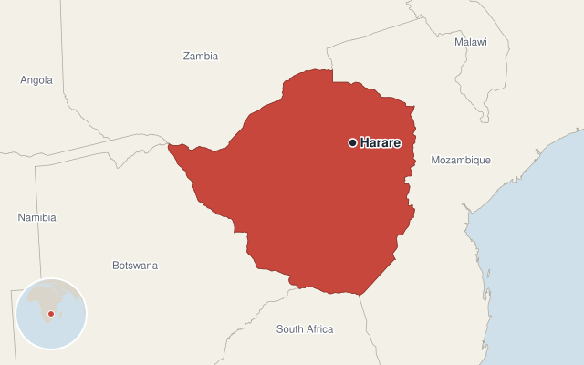

---
id    = "8cbfa4bb-a893-562b-8807-d34471074b1a"
model = "Basic"
tags  = ["africa", "east_africa", "sovereign_state", "flag"]
---

## Front

Whose flag is this?

## Back

<b>Zimbabwe</b>

## Extra

<a href="https://en.wikipedia.org/wiki/Flag_of_Zimbabwe">Flag of Zimbabwe on Wikipedia</a> <a href="https://en.wikipedia.org/wiki/Zimbabwe">Zimbabwe on Wikipedia</a>
