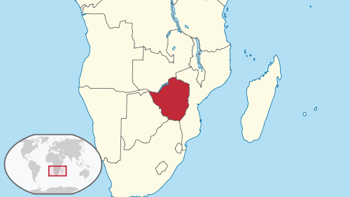
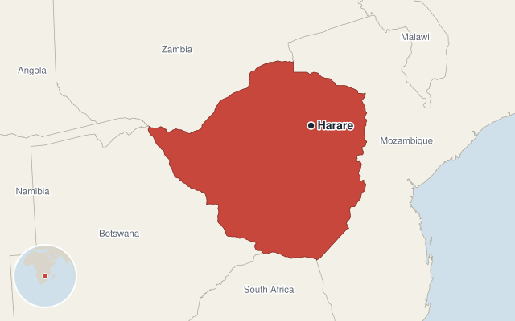

---
id    = "8809b032-6171-5c37-9542-db3a4c0ddf8e"
model = "Basic"
tags  = ["africa", "east_africa", "sovereign_state", "map"]
---

## Front

What is highlighted on this map?

## Back

<b>Zimbabwe</b>

## Extra

<a href="https://en.wikipedia.org/wiki/Zimbabwe">Zimbabwe on Wikipedia</a>
