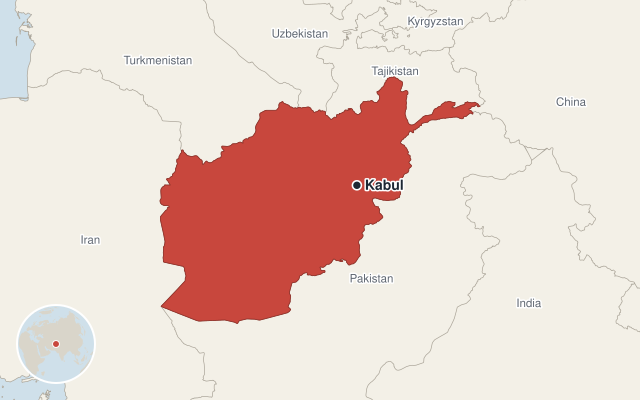
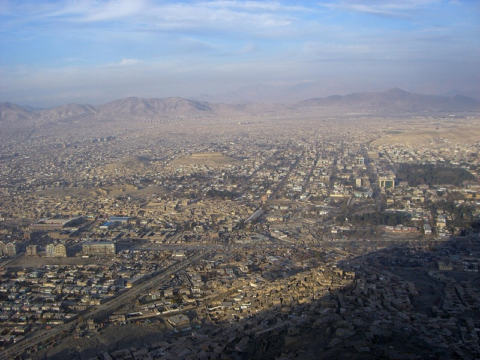

---
id    = "044f3376-d188-5867-b135-05f93313e106"
model = "Basic"
tags  = ["asia", "sovereign_state", "capital"]
---

## Front

What is the capital of <b>Afghanistan</b>?

## Back

<b>Kabul</b>

## Extra

<i>Photo: Sven Dirks, Wien, CC BY-SA 3.0, via Wikimedia Commons</i>

About 5.3 million people (2025 estimate) 1,791 m up, in a narrow valley of the Hindu Kush

In the 16th century the Mughal Empire used Kabul as its summer capital, and the city prospered. The Kabul River bounds it.

<a href="https://en.wikipedia.org/wiki/Kabul">Kabul on Wikipedia</a> <a href="https://en.wikipedia.org/wiki/Afghanistan">Afghanistan on Wikipedia</a>
