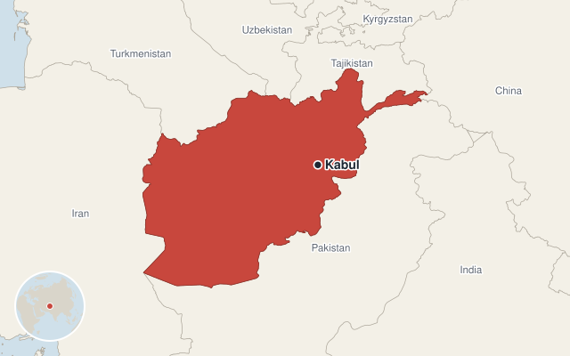

---
id    = "167be7f4-3971-548f-b3dd-db517f86f4bc"
model = "Basic"
tags  = ["asia", "sovereign_state", "country"]
---

## Front

<b>Kabul</b> is the capital of which country or territory?

## Back

<b>Afghanistan</b>

## Extra

About 41 million people (2023) in 652,230 km²

A landlocked country at the crossroads of Central and South Asia. Its land has seen campaigns by the Achaemenids, Alexander the Great, the Mongols, the British and the Soviet Union.

<a href="https://en.wikipedia.org/wiki/Afghanistan">Afghanistan on Wikipedia</a> <a href="https://en.wikipedia.org/wiki/Kabul">Kabul on Wikipedia</a>
