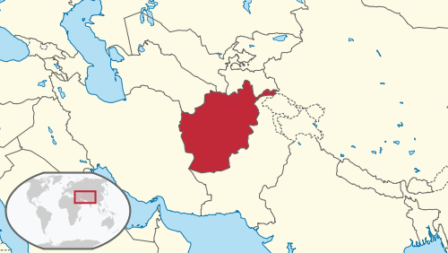
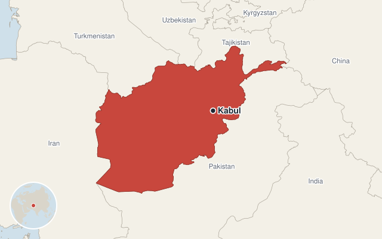

---
id    = "f8a52a6e-cc9e-5bc0-8f51-30883e48893b"
model = "Basic"
tags  = ["asia", "sovereign_state", "map"]
---

## Front

What is highlighted on this map?

## Back

<b>Afghanistan</b>

## Extra

Borders Pakistan, Iran, Turkmenistan, Uzbekistan, Tajikistan and China Highest point: Noshaq

Predominantly mountainous, with plains in the north and the southwest. The Hindu Kush range separates the two.

<a href="https://en.wikipedia.org/wiki/Afghanistan">Afghanistan on Wikipedia</a>
