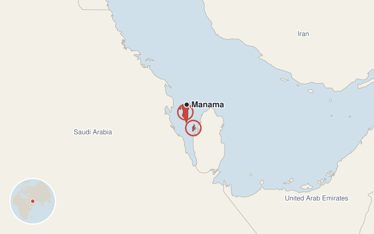

---
id    = "80b32fff-99af-5a39-8033-427f7d1e6611"
model = "Basic"
tags  = ["asia", "middle_east", "sovereign_state", "capital"]
---

## Front

What is the capital of <b>Bahrain</b>?

## Back

<b>Manama</b>

## Extra

About 743,000 people (2025 estimate) On the northeastern coast of Bahrain Island, on the Persian Gulf

After 1602 it became a regional centre for commerce and pearling. It was declared the capital in 1971, when Bahrain gained independence from British protection.

<a href="https://en.wikipedia.org/wiki/Manama">Manama on Wikipedia</a> <a href="https://en.wikipedia.org/wiki/Bahrain">Bahrain on Wikipedia</a>
