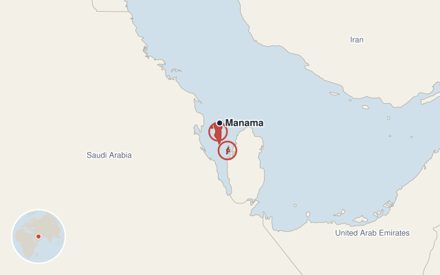

---
id    = "c13fcd3b-5a7f-5113-8cbe-77517e5d8671"
model = "Basic"
tags  = ["asia", "middle_east", "sovereign_state", "country"]
---

## Front

<b>Manama</b> is the capital of which country or territory?

## Back

<b>Bahrain</b>

## Extra

About 2.7 million people (2026) Third-smallest nation in Asia, after the Maldives and Singapore

An island country in the Persian Gulf, famed since antiquity for its pearl fisheries, which were considered the best in the world into the 19th century.

<a href="https://en.wikipedia.org/wiki/Bahrain">Bahrain on Wikipedia</a> <a href="https://en.wikipedia.org/wiki/Manama">Manama on Wikipedia</a>
