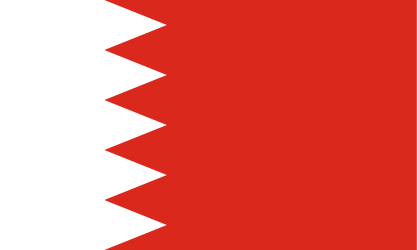
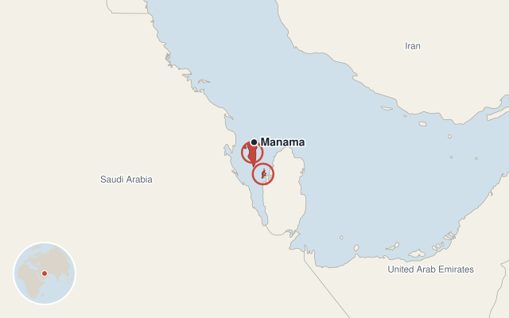

---
id    = "0e2050f5-c576-5250-bcef-6cd9bb4bc9a8"
model = "Basic"
tags  = ["asia", "middle_east", "sovereign_state", "flag"]
---

## Front

Whose flag is this?

## Back

<b>Bahrain</b>

## Extra

Similar flags: Qatar (wider, more serrated edges, maroon)

<a href="https://en.wikipedia.org/wiki/Flag_of_Bahrain">Flag of Bahrain on Wikipedia</a> <a href="https://en.wikipedia.org/wiki/Bahrain">Bahrain on Wikipedia</a>
