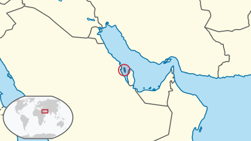
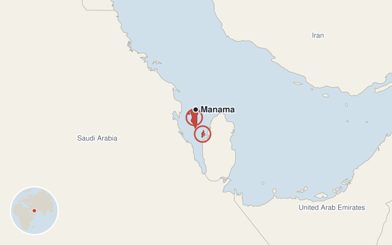

---
id    = "3cda0050-5fcd-58d7-9004-ee80ca8a15cd"
model = "Basic"
tags  = ["asia", "middle_east", "sovereign_state", "map"]
---

## Front

What is highlighted on this map?

## Back

<b>Bahrain</b>

## Extra

A small archipelago of 33 natural and 50 artificial islands Linked to Saudi Arabia by the King Fahd Causeway

Generally flat and arid: a low desert plain rising to a low central escarpment, topped by the 134 m Mountain of Smoke. Bahrain Island makes up around 80 percent of the land.

<a href="https://en.wikipedia.org/wiki/Bahrain">Bahrain on Wikipedia</a>
