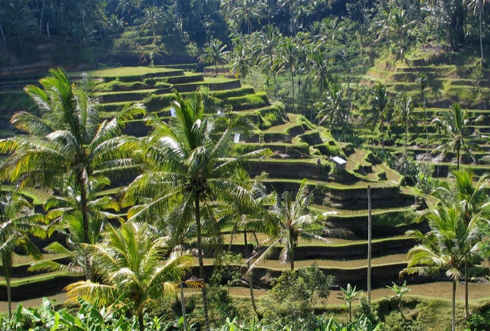

---
id    = "89875fe0-a89a-5386-afbb-1de3695383dc"
model = "Basic"
tags  = ["asia", "map"]
---

## Front

What is highlighted on this map?

## Back

<b>Bali</b>

## Extra

<i>Photo: Unknown author, CC BY-SA 3.0, via Wikimedia Commons</i>

East of Java and west of Lombok About 4.4 million people (2024) in about 5,780 km²

Bali is the only Hindu-majority province in Indonesia, with 86.40% of its people adhering to Balinese Hinduism. It is also the country's main tourist destination.

Island of Indonesia.

<a href="https://en.wikipedia.org/wiki/Bali">Bali on Wikipedia</a>
