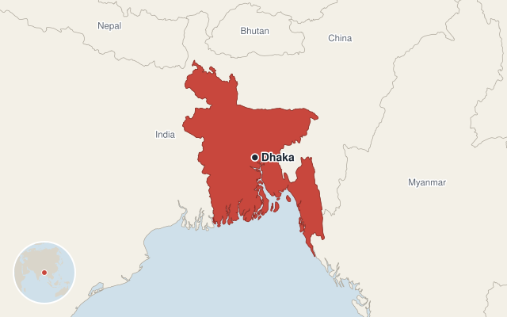

---
id    = "fc83ac09-4bdc-5aa6-b52f-363bbfc67115"
model = "Basic"
tags  = ["asia", "sovereign_state", "capital"]
---

## Front

What is the capital of <b>Bangladesh</b>?

## Back

<b>Dhaka</b>

## Extra

<a href="https://en.wikipedia.org/wiki/Dhaka">Dhaka on Wikipedia</a> <a href="https://en.wikipedia.org/wiki/Bangladesh">Bangladesh on Wikipedia</a>
