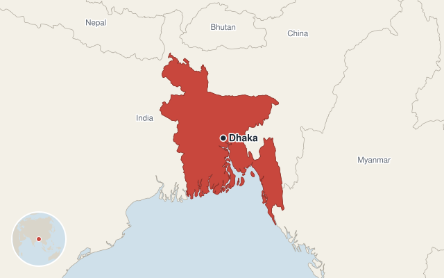

---
id    = "2362e7e9-b5a8-50cb-9350-d02dc2c1373e"
model = "Basic"
tags  = ["asia", "sovereign_state", "country"]
---

## Front

<b>Dhaka</b> is the capital of which country or territory?

## Back

<b>Bangladesh</b>

## Extra

About 176 million people (2025) in about 148,000 km²

The eighth-most populous country in the world, and one of the most densely populated. Chittagong is the second-largest city and the country's busiest port.

<a href="https://en.wikipedia.org/wiki/Bangladesh">Bangladesh on Wikipedia</a> <a href="https://en.wikipedia.org/wiki/Dhaka">Dhaka on Wikipedia</a>
