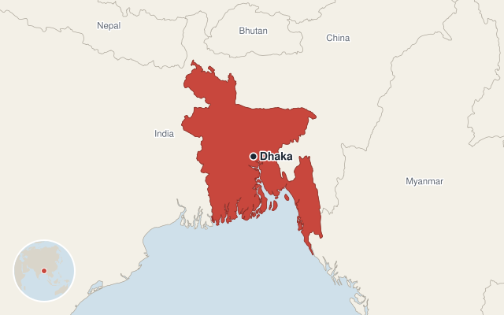

---
id    = "d0e80ed6-e197-5a54-9817-0b3e7be4e56e"
model = "Basic"
tags  = ["asia", "sovereign_state", "flag"]
---

## Front

Whose flag is this?

## Back

<b>Bangladesh</b>

## Extra

<a href="https://en.wikipedia.org/wiki/Flag_of_Bangladesh">Flag of Bangladesh on Wikipedia</a> <a href="https://en.wikipedia.org/wiki/Bangladesh">Bangladesh on Wikipedia</a>
