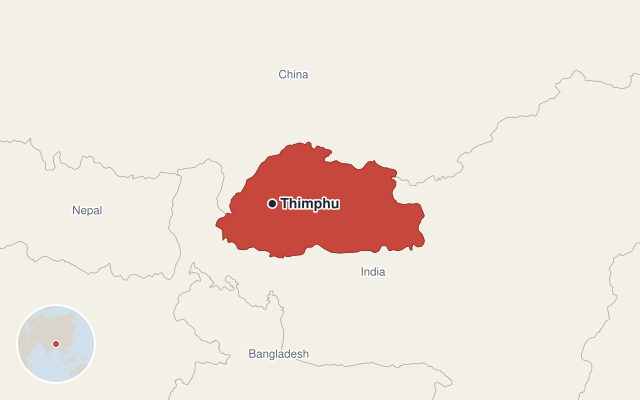

---
id    = "c734f32f-2656-5ce3-b62c-dcb3073556af"
model = "Basic"
tags  = ["asia", "sovereign_state", "capital"]
---

## Front

What is the capital of <b>Bhutan</b>?

## Back

<b>Thimphu</b>

## Extra

<a href="https://en.wikipedia.org/wiki/Thimphu">Thimphu on Wikipedia</a> <a href="https://en.wikipedia.org/wiki/Bhutan">Bhutan on Wikipedia</a>
