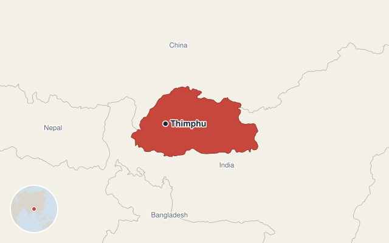

---
id    = "0223d680-61d8-53eb-b0a2-fb3c92ee2c6e"
model = "Basic"
tags  = ["asia", "sovereign_state", "country"]
---

## Front

<b>Thimphu</b> is the capital of which country or territory?

## Back

<b>Bhutan</b>

## Extra

About 797,000 people (2025) in 38,394 km²

Its official name since the 17th century has been Druk yul, "the Land of the Thunder Dragon". "Bhutan" appears only in English-language official correspondence.

<a href="https://en.wikipedia.org/wiki/Bhutan">Bhutan on Wikipedia</a> <a href="https://en.wikipedia.org/wiki/Thimphu">Thimphu on Wikipedia</a>
