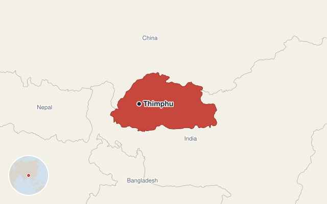

---
id    = "9eb122b3-b422-5dce-9448-db73a059edd7"
model = "Basic"
tags  = ["asia", "sovereign_state", "flag"]
---

## Front

Whose flag is this?

## Back

<b>Bhutan</b>

## Extra

<a href="https://en.wikipedia.org/wiki/Flag_of_Bhutan">Flag of Bhutan on Wikipedia</a> <a href="https://en.wikipedia.org/wiki/Bhutan">Bhutan on Wikipedia</a>
