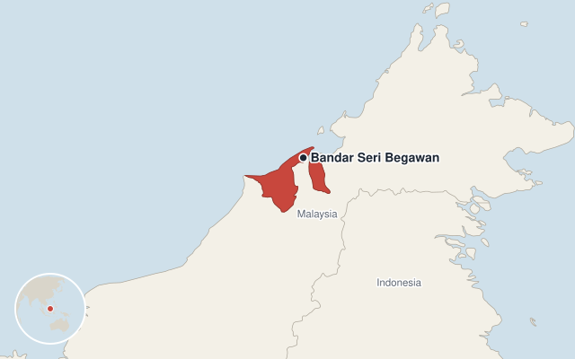

---
id    = "e4f8354e-d638-582a-a849-3693e60b7695"
model = "Basic"
tags  = ["asia", "southeast_asia", "sovereign_state", "capital"]
---

## Front

What is the capital of <b>Brunei</b>?

## Back

<b>Bandar Seri Begawan</b>

## Extra

<a href="https://en.wikipedia.org/wiki/Bandar_Seri_Begawan">Bandar Seri Begawan on Wikipedia</a> <a href="https://en.wikipedia.org/wiki/Brunei">Brunei on Wikipedia</a>
