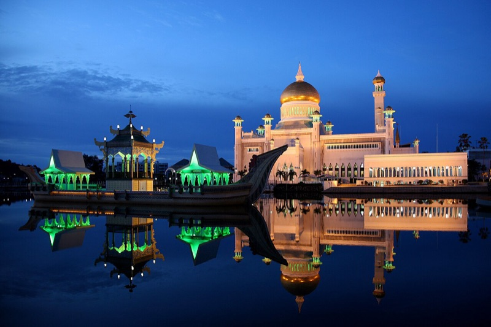

---
id    = "e4f8354e-d638-582a-a849-3693e60b7695"
model = "Basic"
tags  = ["asia", "southeast_asia", "sovereign_state", "capital"]
---

## Front

What is the capital of <b>Brunei</b>?

## Back

<b>Bandar Seri Begawan</b>

## Extra

<i>Photo: sam garza from Los Angeles, USA, CC BY 2.0, via Wikimedia Commons</i>

About 72,000 people (2025 estimate), in the municipal area In Brunei–Muara District, home to over 70 percent of the country's people

Known as Brunei Town until 1970, when it was renamed for Omar Ali Saifuddien III, the 28th Sultan. It grew from a Malay stilt settlement on the Brunei River, the forerunner of Kampong Ayer.

<a href="https://en.wikipedia.org/wiki/Bandar_Seri_Begawan">Bandar Seri Begawan on Wikipedia</a> <a href="https://en.wikipedia.org/wiki/Brunei">Brunei on Wikipedia</a>
