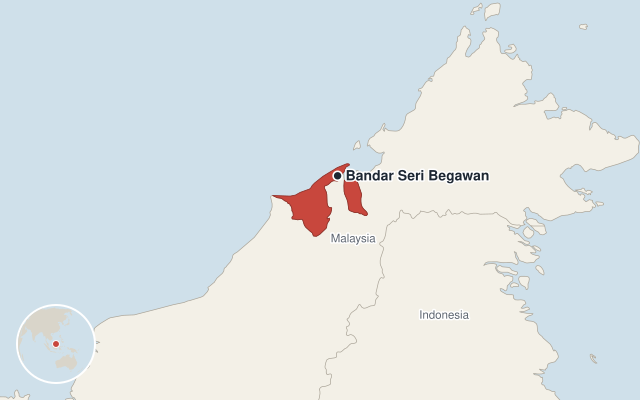

---
id    = "57c284f5-0b7c-5eb6-8f74-9b0dad5c3ced"
model = "Basic"
tags  = ["asia", "southeast_asia", "sovereign_state", "country"]
---

## Front

<b>Bandar Seri Begawan</b> is the capital of which country or territory?

## Back

<b>Brunei</b>

## Extra

<a href="https://en.wikipedia.org/wiki/Brunei">Brunei on Wikipedia</a> <a href="https://en.wikipedia.org/wiki/Bandar_Seri_Begawan">Bandar Seri Begawan on Wikipedia</a>
