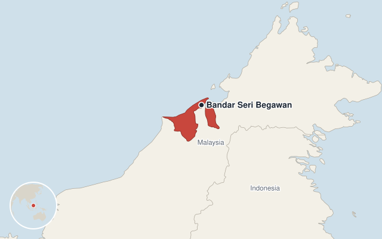

---
id    = "77bb94d6-0e33-546f-91a9-198c3e136834"
model = "Basic"
tags  = ["asia", "southeast_asia", "sovereign_state", "flag"]
---

## Front

Whose flag is this?

## Back

<b>Brunei</b>

## Extra

<a href="https://en.wikipedia.org/wiki/Flag_of_Brunei">Flag of Brunei on Wikipedia</a> <a href="https://en.wikipedia.org/wiki/Brunei">Brunei on Wikipedia</a>
