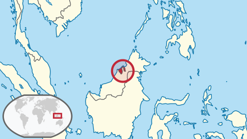
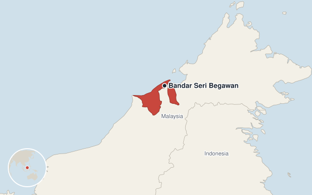

---
id    = "a96db5de-1d91-5504-ba37-139a66eebd85"
model = "Basic"
tags  = ["asia", "southeast_asia", "sovereign_state", "map"]
---

## Front

What is highlighted on this map?

## Back

<b>Brunei</b>

## Extra

The only sovereign state entirely on Borneo Highest point: Bukit Pagon

Apart from its South China Sea coast, it is completely surrounded by the Malaysian state of Sarawak, and the Sarawak district of Limbang splits its territory in two.

<a href="https://en.wikipedia.org/wiki/Brunei">Brunei on Wikipedia</a>
