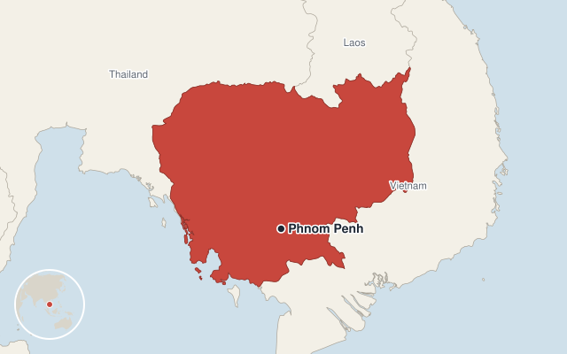

---
id    = "52d7fac0-f120-5a51-a298-91c1f9a0df0e"
model = "Basic"
tags  = ["asia", "southeast_asia", "sovereign_state", "capital"]
---

## Front

What is the capital of <b>Cambodia</b>?

## Back

<b>Phnom Penh</b>

## Extra

<a href="https://en.wikipedia.org/wiki/Phnom_Penh">Phnom Penh on Wikipedia</a> <a href="https://en.wikipedia.org/wiki/Cambodia">Cambodia on Wikipedia</a>
