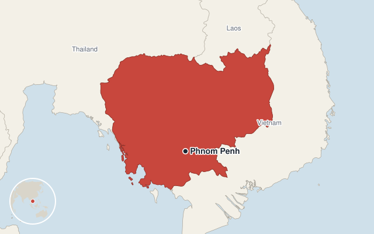

---
id    = "07557e6f-8216-5cbe-8435-f5410ce1d6f9"
model = "Basic"
tags  = ["asia", "southeast_asia", "sovereign_state", "country"]
---

## Front

<b>Phnom Penh</b> is the capital of which country or territory?

## Back

<b>Cambodia</b>

## Extra

<a href="https://en.wikipedia.org/wiki/Cambodia">Cambodia on Wikipedia</a> <a href="https://en.wikipedia.org/wiki/Phnom_Penh">Phnom Penh on Wikipedia</a>
