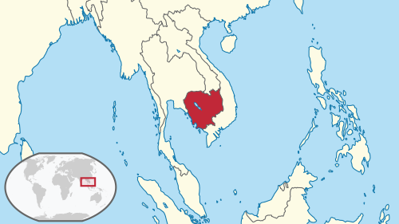

---
id    = "3d6caa87-3443-5ba9-9053-2b86d59ba188"
model = "Basic"
tags  = ["asia", "southeast_asia", "sovereign_state", "map"]
---

## Front

What is highlighted on this map?

## Back

<b>Cambodia</b>
