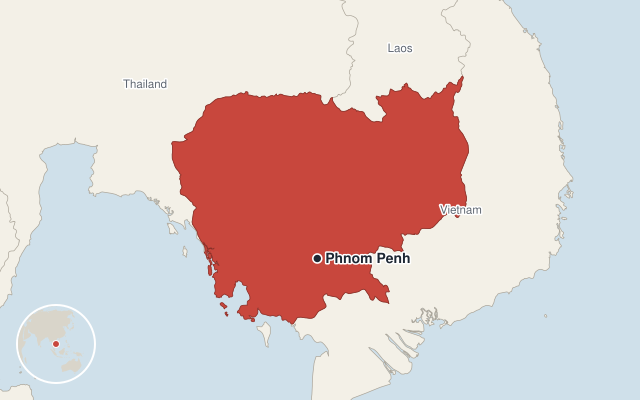

---
id    = "3d6caa87-3443-5ba9-9053-2b86d59ba188"
model = "Basic"
tags  = ["asia", "southeast_asia", "sovereign_state", "map"]
---

## Front

What is highlighted on this map?

## Back

<b>Cambodia</b>

## Extra

Borders Thailand, Laos and Vietnam, with a coast on the Gulf of Thailand Highest point: Phnom Aural

A low-lying plain, dominated by the confluence of the Mekong river and Tonlé Sap, Southeast Asia's largest lake.

<a href="https://en.wikipedia.org/wiki/Cambodia">Cambodia on Wikipedia</a>
