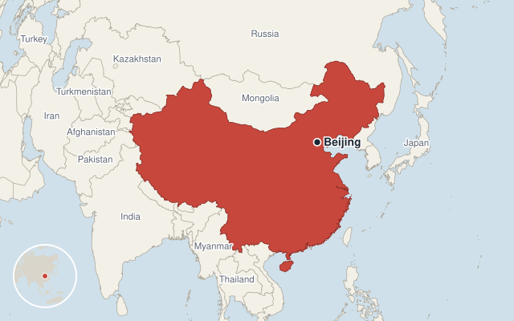
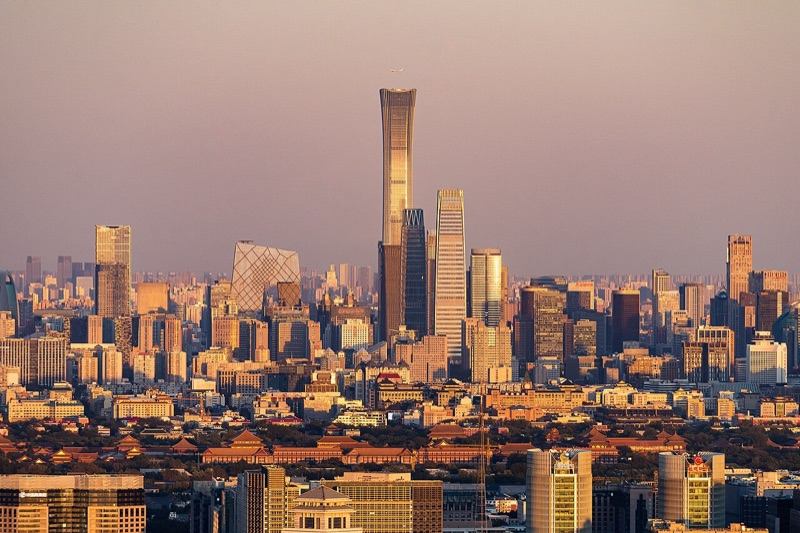

---
id    = "6b1695a4-e733-5272-88f6-214a3d433ae4"
model = "Basic"
tags  = ["asia", "sovereign_state", "capital"]
---

## Front

What is the capital of <b>China</b>?

## Back

<b>Beijing</b>

## Extra

<i>Photo: N509FZ, CC BY-SA 4.0, via Wikimedia Commons</i>

More than 21.8 million residents (2020 census) Stands 43 m above sea level

The world's most populous national capital, and the last of the Four Great Ancient Capitals of China. It has been the country's political center for most of the past eight centuries.

<a href="https://en.wikipedia.org/wiki/Beijing">Beijing on Wikipedia</a> <a href="https://en.wikipedia.org/wiki/China">China on Wikipedia</a>
