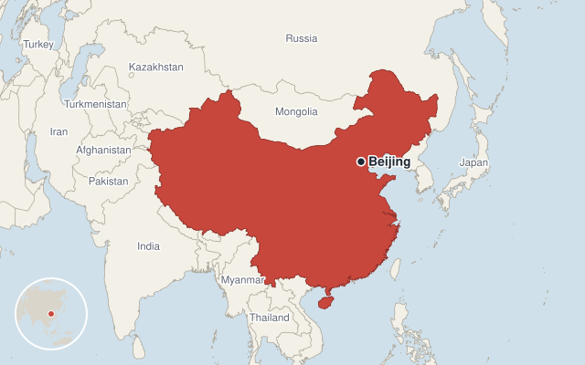

---
id    = "a153c611-eb85-5f4d-a369-354e774a1764"
model = "Basic"
tags  = ["asia", "sovereign_state", "country"]
---

## Front

<b>Beijing</b> is the capital of which country or territory?

## Back

<b>China</b>

## Extra

<a href="https://en.wikipedia.org/wiki/China">China on Wikipedia</a> <a href="https://en.wikipedia.org/wiki/Beijing">Beijing on Wikipedia</a>
