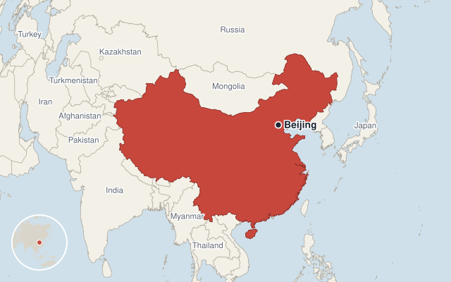
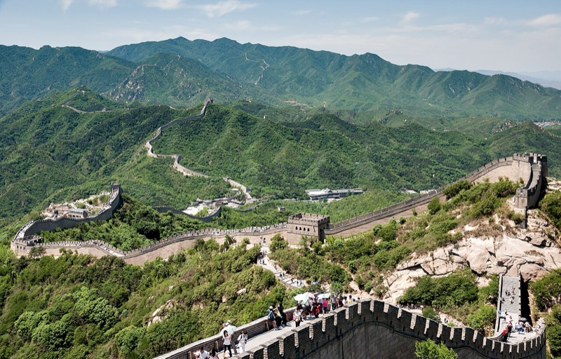

---
id    = "37ad2d56-ca60-5a40-bd43-9a949ba34556"
model = "Basic"
tags  = ["asia", "sovereign_state", "map"]
---

## Front

What is highlighted on this map?

## Back

<b>China</b>

## Extra

<i>Photo: Photo by CEphoto, Uwe Aranas or alternatively © CEphoto, Uwe Aranas, CEphoto, Uwe Aranas, via Wikimedia Commons</i>

Borders Russia, Mongolia, India and Vietnam Highest point is Mount Everest

Its landscape includes the Himalayas, plateaus, deserts and forests, and the Yangtze and Yellow rivers cross the Central Plain.

<a href="https://en.wikipedia.org/wiki/China">China on Wikipedia</a>
