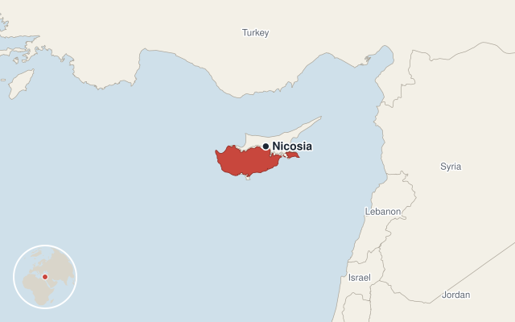
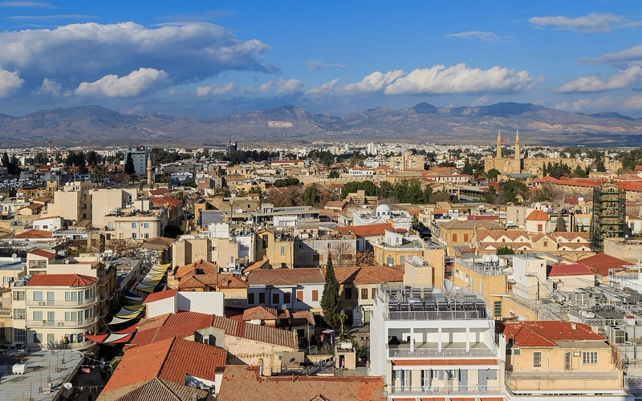

---
id    = "26726110-adb3-5f97-8806-34dc87356bef"
model = "Basic"
tags  = ["asia", "european_union", "mediterranean", "middle_east", "sovereign_state", "capital"]
---

## Front

What is the capital of <b>Cyprus</b>?

## Back

<b>Nicosia</b>

## Extra

<i>Photo: A.Savin, FAL, via Wikimedia Commons</i>

About 57,000 people (2021)

The last divided capital in Europe: the dividing line since 1974 runs through the city. It has been Cyprus's capital since the 10th century.

<a href="https://en.wikipedia.org/wiki/Nicosia">Nicosia on Wikipedia</a> <a href="https://en.wikipedia.org/wiki/Cyprus">Cyprus on Wikipedia</a>
