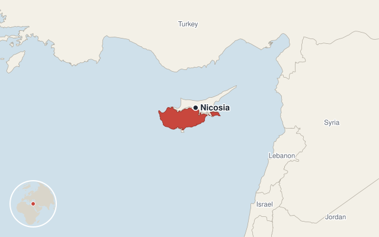

---
id    = "394bdc7b-6ada-5548-ab81-7ddbc3485d38"
model = "Basic"
tags  = ["asia", "european_union", "mediterranean", "middle_east", "sovereign_state", "country"]
---

## Front

<b>Nicosia</b> is the capital of which country or territory?

## Back

<b>Cyprus</b>

## Extra

About 1.34 million people (2023) in 9,242 km² Third largest island in the Mediterranean

An island country in the eastern Mediterranean off the coast of the Levant. The Republic shares the island with the north, which is recognised only by Turkey, along a UN Buffer Zone.

<a href="https://en.wikipedia.org/wiki/Cyprus">Cyprus on Wikipedia</a> <a href="https://en.wikipedia.org/wiki/Nicosia">Nicosia on Wikipedia</a>
