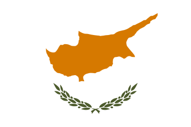

---
id    = "456d4ae0-9e4e-5b36-a12e-7088dcad4429"
model = "Basic"
tags  = ["asia", "european_union", "mediterranean", "middle_east", "sovereign_state", "flag"]
---

## Front

Whose flag is this?

## Back

<b>Cyprus</b>
