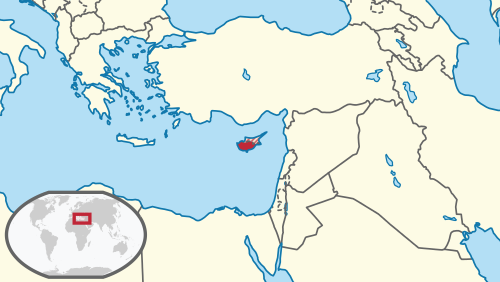
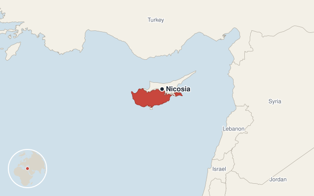

---
id    = "e76d99c0-4961-5e78-8fd4-c4011c4135f8"
model = "Basic"
tags  = ["asia", "european_union", "mediterranean", "middle_east", "sovereign_state", "map"]
---

## Front

What is highlighted on this map?

## Back

<b>Cyprus</b>

## Extra

Highest point is Mount Olympus Third largest and third most populous island in the Mediterranean

A single island off the Levant coast. The UN Buffer Zone divides it into the Republic of Cyprus and the north, along with two British sovereign base areas in the south.

<a href="https://en.wikipedia.org/wiki/Cyprus">Cyprus on Wikipedia</a>
