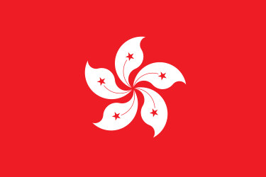
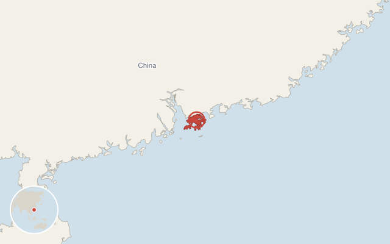

---
id    = "7045e4c3-f09d-57ef-a5da-f22c0c694c6d"
model = "Basic"
tags  = ["asia", "flag"]
---

## Front

Whose flag is this?

## Back

<b>Hong Kong</b>

## Extra

Adopted and hoisted on 1 July 1997, at the handover from the United Kingdom to China

A white five-petal Hong Kong orchid tree flower on red. The flag's design is set out in the territory's Basic Law.

Special Administrative Region of China.

<a href="https://en.wikipedia.org/wiki/Flag_of_Hong_Kong">Flag of Hong Kong on Wikipedia</a> <a href="https://en.wikipedia.org/wiki/Hong_Kong">Hong Kong on Wikipedia</a>
