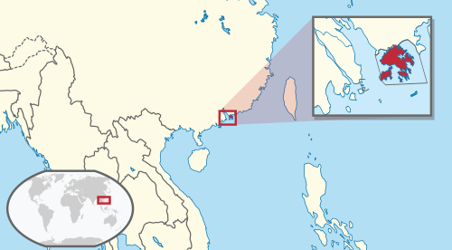
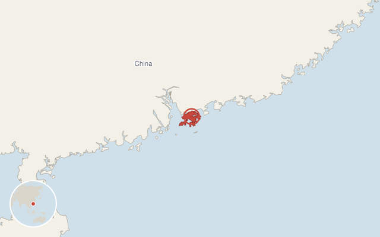

---
id    = "0f4e7778-fc94-55ed-9f2f-35c183d31d1a"
model = "Basic"
tags  = ["asia", "map"]
---

## Front

What is highlighted on this map?

## Back

<b>Hong Kong</b>

## Extra

Special Administrative Region of China.

<a href="https://en.wikipedia.org/wiki/Hong_Kong">Hong Kong on Wikipedia</a>
