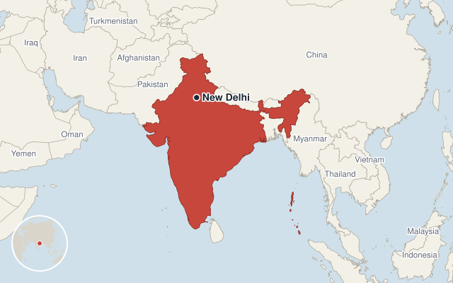

---
id    = "9e1496e4-a546-50fa-a411-2392abfb8fa7"
model = "Basic"
tags  = ["asia", "sovereign_state", "capital"]
---

## Front

What is the capital of <b>India</b>?

## Back

<b>New Delhi</b>

## Extra

<a href="https://en.wikipedia.org/wiki/New_Delhi">New Delhi on Wikipedia</a> <a href="https://en.wikipedia.org/wiki/India">India on Wikipedia</a>
