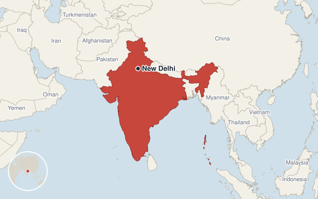

---
id    = "a67f0c11-b53d-55b3-b1c5-54286cd5ffb1"
model = "Basic"
tags  = ["asia", "sovereign_state", "country"]
---

## Front

<b>New Delhi</b> is the capital of which country or territory?

## Back

<b>India</b>

## Extra

About 1.33 billion people (2020), the most of any country Highest point is Kanchenjunga

The world's most populous country and seventh largest by area. It is bounded by the Indian Ocean, the Arabian Sea and the Bay of Bengal.

<a href="https://en.wikipedia.org/wiki/India">India on Wikipedia</a> <a href="https://en.wikipedia.org/wiki/New_Delhi">New Delhi on Wikipedia</a>
