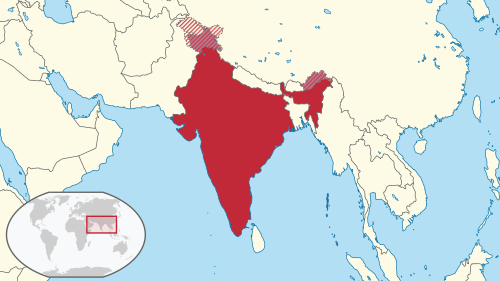
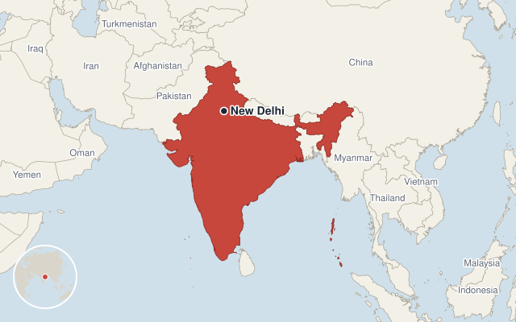

---
id    = "e7d6c9d0-eda3-5f81-98fb-a75a3d4ca50d"
model = "Basic"
tags  = ["asia", "sovereign_state", "map"]
---

## Front

What is highlighted on this map?

## Back

<b>India</b>

## Extra

<a href="https://en.wikipedia.org/wiki/India">India on Wikipedia</a>
