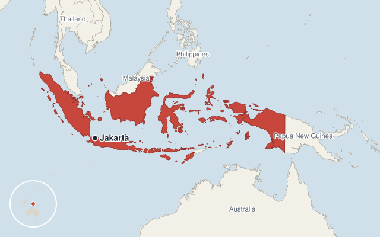

---
id    = "f0fd0aa8-a8d8-5515-a4fa-15acb0cde054"
model = "Basic"
tags  = ["asia", "southeast_asia", "sovereign_state", "capital"]
---

## Front

What is the capital of <b>Indonesia</b>?

## Back

<b>Jakarta</b>

## Extra

<a href="https://en.wikipedia.org/wiki/Jakarta">Jakarta on Wikipedia</a> <a href="https://en.wikipedia.org/wiki/Indonesia">Indonesia on Wikipedia</a>
