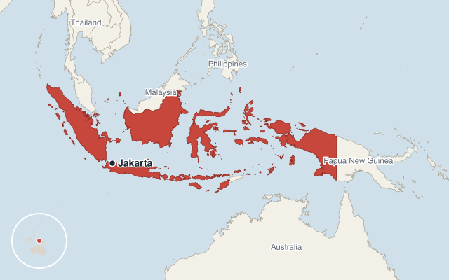

---
id    = "afa948de-77a2-5175-8294-5957e310a759"
model = "Basic"
tags  = ["asia", "southeast_asia", "sovereign_state", "country"]
---

## Front

<b>Jakarta</b> is the capital of which country or territory?

## Back

<b>Indonesia</b>

## Extra

<a href="https://en.wikipedia.org/wiki/Indonesia">Indonesia on Wikipedia</a> <a href="https://en.wikipedia.org/wiki/Jakarta">Jakarta on Wikipedia</a>
