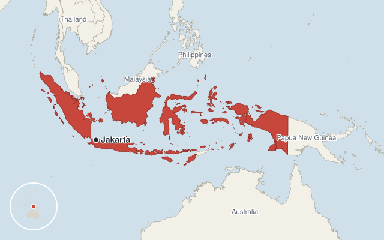

---
id    = "662d18bc-cd3d-53c9-98ae-1832bf18ced1"
model = "Basic"
tags  = ["asia", "southeast_asia", "sovereign_state", "flag"]
---

## Front

Whose flag is this?

## Back

<b>Indonesia</b>

## Extra

Hoisted at the proclamation of independence on 17 August 1945

Red over white, 2:3. Graphically similar to Monaco's flag, with a slightly different red and ratio. Poland's has the same dimensions with the colours reversed.

Similar flags: Monaco (narrower, darker red), Poland (red and white flipped, darker red)

<a href="https://en.wikipedia.org/wiki/Flag_of_Indonesia">Flag of Indonesia on Wikipedia</a> <a href="https://en.wikipedia.org/wiki/Indonesia">Indonesia on Wikipedia</a>
